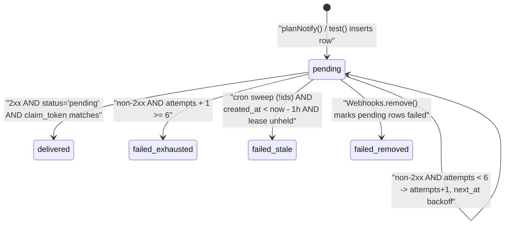

# Webhook Outbox Cutover Model

Formal cutover model for restoring `src/server/notify.ts` on `agent-workroom-main` with pre-existing stale rows (`> 1h`) in remote D1 `webhook_outbox`.

## Files

- `WebhookOutbox.tla` / `WebhookOutbox.cfg`: TLA+ specification and TLC configuration covering `PostImmediateDeliver`, `CronSweep`, fenced `CompleteOk` / `CompleteErr` (`0017` `claim_token` / `claimed_until`), `WebhookRemove`, and clock advance `Tick`.
- `../../../tests/webhook-outbox-model.test.ts`: Exhaustive small-state BFS model checker executing the exact TLA+ state machine and verifying all invariants across every reachable state (including negative controls with fencing or stale expiry disabled).

## Statechart

## Checked Invariants

1. `InvDeliveredAtMostOnce`: Every row transitions to `delivered` at most once (`deliveredCount <= 1`), even when a claim lease expires mid-flight and a second worker reclaims the row.
2. `InvNoStaleSweepDelivery`: `CronSweep` (`deliver(db)` without explicit `ids`) never attempts delivery for any row older than `STALE_OUTBOX_MS` (1h).
3. `InvBatchBound`: `CronSweep` never claims more than `LIMIT 25` rows in a single sweep (modeled at `SweepLimit = 2` with 3 rows to exercise the cap).
4. `InvFreshNotExpiredEarly`: Fresh rows (`age <= STALE_OUTBOX_MS`) are never marked `expired stale`, and `post()` immediate delivery of a fresh row cannot trigger stale expiry.
5. `InvRetryCap`: `attempts <= MAX_ATTEMPTS (6)` across all paths.
