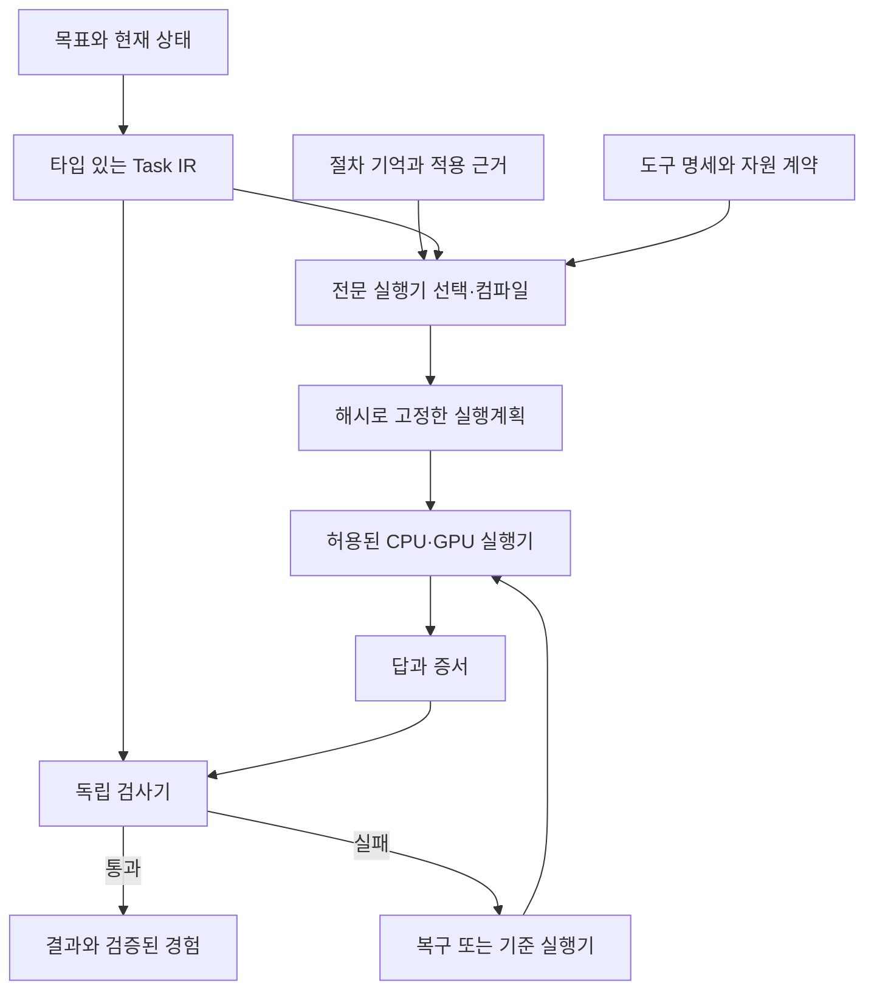

# 검증 가능한 도구 전문화와 작은 모델의 역할

작성일: 2026-11-25. 범위: 공개 선행연구와 새로 작성한 합성 그래프 데모. 이 문서에 비공개 프로젝트 소스나 데이터를 복사하지 않았다.

## 1. 설계 결론과 구현 상태

워크룸의 자율 하네스는 **모델·도구·절차 기억을 함께 개선하되, 실행 권한과 결과 인정 조건은 고정된 검증 경계를 통과하도록** 설계하는 것이 타당하다. 모델이 모든 문제를 직접 풀 필요는 없다. 반복되는 문제를 작은 실행기로 옮기고, 그 실행기가 산출한 답을 저렴한 독립 검사기로 확인할 수 있다면 재사용할수록 비용이 줄어들 가능성이 있다. 단, 실행기 생성·검증·유지비까지 합산했을 때 강한 기존 알고리즘보다 유리해야 한다.

이번에 실제 구현한 것은 다음이다.

- CPU에서 실행하는 표준 라이브러리 Python 도구 네 가지: BFS, Dijkstra, Bellman–Ford, 단계별 Bellman–Ford의 논리적 도구 경계를 계산하는 비교 조건.
- 유효한 입력, 도구 버전, 스키마, 가용 자원, 실행 예산을 확인하는 제한된 도구 컴파일러.
- 절차 기억에서 받은 알고리즘 선호를 현재 입력의 전제조건에 다시 대조하는 인터페이스.
- 원본 입력 해시, 도구 명세 해시, 전체 실행계획 해시를 실행 직전에 다시 확인하는 경계.
- 최단경로의 **최적성** 또는 경로 부재를 검사하는 독립 증서 검사기.
- 32개 단위 테스트, 60개 별도 합성 그래프에 대한 독립 Floyd–Warshall 정답 대조, 48개 문제 × 4개 실행 조건의 기전 실험.

신경망 학습, GPU 실행, 원격 MCP 호출, 임의 코드 생성, 운영 하네스의 자동 교체는 이 모듈에서 실행하지 않았다. 따라서 이 결과는 학습된 트랜스포머나 일반 에이전트의 성능 향상을 입증하지 않는다.

## 2. 첨부 이미지의 원문을 확인한 결과

[Looped Weight-Space Programming 공식 연구 글](https://mbzuai-oryx.github.io/LoopedWSP/)은 2026년 11월 23일에 게시되었다. 저자는 LLM이 가중치를 설정하는 코드를 작성했으며, 해당 전문 실행기는 경사하강 학습 없이 동작한다고 보고한다. 이것은 사전학습된 LLM 자체가 전혀 학습되지 않았다는 뜻이 아니다.

비교 조건을 함께 읽어야 한다.

| 항목 | 공식 글이 보고한 범위 | 설계에서의 해석 |
|---|---|---|
| 직접 미로 풀이 26% | 인용한 LLM 비교는 Maze-Hard 테스트 1,000개 중 앞의 50개 | 전체 1,000개를 대상으로 모든 조건을 통제한 26→100 실험으로 쓰지 않는다 |
| 기본 전문 모델 | 19,936개 가중치, Maze-Hard 테스트 100%, 별도의 100×100 미로 평가 | 정의된 알고리즘 과제에서 반복 상태 갱신을 신경망에 담을 수 있다는 사례 |
| 제작 39분, 약 $19 | 기본 모델의 세션: 196,771 출력 토큰, 정가 환산 $18.71, 3회 수정; 테스트 비용 제외 | 실제 현금 지출액과 다르며, 모든 비용을 포함한 운영 TCO로 해석하지 않는다 |
| 928개 가중치 | 별도의 1,000개 가중치 제한 세션: 7시간 32분, 정가 환산 $17.56, 3회 수정 | 928개 모델을 39분에 만들었다고 합쳐 쓰면 안 된다 |

저자들이 사용한 것은 반복 가능한 알고리즘의 상태와 갱신 규칙이다. 그 결과에서 곧바로 “자유로운 장기 프로젝트도 정답률 100%” 또는 “작은 신경망이 모든 CPU 알고리즘보다 싸다”를 도출할 수 없다. 원문의 정확도는 해당 평가 결과이고, 부동소수점 신경망 구현 전체의 Lean 증명은 제시한 수치와 별개의 문제다. 위 수치와 조건의 출처는 모두 [공식 글의 본문 및 비용 표](https://mbzuai-oryx.github.io/LoopedWSP/)다.

## 3. 선행연구에서 가져올 수 있는 구조

| 1차 자료 | 확인한 핵심 내용 | 워크룸에 가져올 요소 | 남는 한계 |
|---|---|---|---|
| [Looped Transformers as Programmable Computers, ICML 2023](https://proceedings.mlr.press/v202/giannou23a.html) | 특정 가중치와 반복 구조로 계산 블록·프로그램 실행을 구성한다 | 상태 전이와 반복 한도를 명시한 전문 실행기 | 구성 가능성은 실제 업무에서 학습·속도·신뢰성이 자동 확보된다는 뜻이 아니다 |
| [Tracr 공식 저장소](https://github.com/google-deepmind/tracr), [논문](https://arxiv.org/abs/2301.05062) | 제한된 RASP 프로그램을 중간 표현을 거쳐 트랜스포머 가중치로 컴파일한다 | 자연어→타입 있는 DSL→검사 가능한 IR→실행기라는 단계 | 범용 Python이나 모든 업무를 그대로 컴파일하는 도구가 아니다 |
| [Tiny Recursive Models, 원문](https://arxiv.org/html/2510.04871), [공식 코드](https://github.com/SamsungSAILMontreal/TinyRecursiveModels) | 작은 반복 신경망과 깊은 감독을 사용하는 학습 방법 | 고정된 구조의 반복 추론·정지 정책을 별도 실험할 근거 | 학습된 모델이며 LoopedWSP의 무경사 가중치 구성과 다르다. 퍼즐 평가를 실제 장기 업무 성능으로 옮겨 읽을 수 없다 |
| [RECAST, 원문](https://arxiv.org/html/2610.10507) | RouterLM이 검색·연산·도구 합성을 선택하고, CompilerLM과 AnswerLM은 고정한 채 라우터를 SFT·GRPO로 학습한다 | 검색만으로 없는 증거는 계산해 만들어야 한다는 분업; 학습 대상을 좁히는 방법 | 실행 데이터 수집과 반복 호출·합성의 비용이 추가된다. 논문도 비용 최적화를 남은 과제로 설명한다 |
| [xRouter, 원문](https://arxiv.org/abs/2510.08439) | 에피소드 성공과 전체 모델 호출 비용을 함께 반영해 라우팅 정책을 학습한다 | 단일 호출 가격보다 목표 완수까지의 총비용을 라벨과 보상으로 사용 | 값싼 모델로 한 번 대체한 이익이 재시도·복구 비용 때문에 사라질 수 있다. 우리 프로젝트 성능은 별도 측정해야 한다 |
| [VerMCTS, 원문](https://arxiv.org/abs/2402.08147) | 논리 검증기를 프로그램 탐색 과정에 연결해 부분 프로그램에서 피드백을 얻는다 | 실패 후 자연어 반성만 저장하지 않고, 실패한 의무·반례·남은 의무로 탐색을 갱신 | 논문의 Dafny·Coq 결과가 새 Lean 명세나 실행기와 자동으로 연결되지는 않는다 |
| [MCP Tools, 2026-07-28 명세](https://modelcontextprotocol.io/specification/2026-07-28/server/tools) | 도구 목록·입출력 스키마·호출·목록 변경을 다룬다. 이름은 서버별로 고유하며 주석은 신뢰 여부를 별도로 판단해야 한다 | 도구 이름만 기억하지 않고 서버 신원·명세 버전·스키마 해시·효과 계약을 묶어 식별 | discovery는 사용 권한이나 CPU/GPU 자원을 만들어 주지 않는다 |
| [MCP Tasks, 2025-11-25 명세](https://modelcontextprotocol.io/specification/2025-11-25/basic/utilities/tasks) | 지연 결과 조회·취소·TTL·동시 작업 제한을 다루는 당시 experimental 인터페이스 | 장시간 평가·학습 작업을 비동기 job으로 관리 | 버전이 고정된 설계 참고다. 실제 서버가 협상한 프로토콜·기능을 확인해야 하며 신버전 동작을 추정하면 안 된다 |

이 연구 묶음은 “생성기, 실행기, 검사기를 나누고 반복 경험을 작은 정책에 압축한다”는 구조를 지지한다. 워크룸에서 이 조합이 얼마나 좋아질지는 새 실험의 가설이다. 기존 논문들이 이미 우리의 전체 아키텍처를 검증했다고 주장하지 않는다.

## 4. 도구 전문화의 구조



### 4.1 고수준 목표와 형식 문제의 연결

최단경로 데모에서 입력은 유한 방향 그래프, 비음수 정수 가중치, 출발점과 목적점이다. 실제 업무에서는 이보다 앞에 자연어 목표를 형식 문제로 바꾸는 단계가 있다. 예를 들어 “이 연구를 끝내라”를 바로 그래프로 간주할 수 없다. 우선 산출물, 선행 조건, 외부 작업의 효과, 승인된 자원, 완료 판정 기준을 타입 있는 `Task IR`로 추출해야 한다.

형식 문제의 해답이 실제 목표를 만족한다는 연결도 검사해야 한다. 프로젝트의 명세를 잘못 추출했다면 그래프 해답이 완벽해도 업무는 틀린다. 따라서 다음 세 가지 의무를 분리한다.

1. **명세 충실성:** 원래 목표·도구의 실제 효과가 IR과 맞는가.
2. **실행기 정확성:** 그 IR에서 실행기의 답이 옳은가.
3. **실행 연결성:** 실제 실행 입력·도구 버전·결과가 검증한 것과 같은가.

현재 증서는 2번의 한정된 그래프 성질을 다룬다. 해시 검사는 3번을 보조한다. 해시는 서명이나 권한 부여가 아니며 1번을 증명하지 않는다.

### 4.2 증서를 가진 작은 실행기

잠재함수 `p`와 반환 경로 `P`가 다음을 만족하게 한다.

\[
p(s)=0,\qquad \forall (u,v,w)\in E,\ p(v)\le p(u)+w,\qquad
\operatorname{cost}(P)=p(t).
\]

임의의 경쟁 경로에 부등식을 이어 적용하면 `p(t)` 이하로 비용이 내려갈 수 없다. 실제 경로 `P`가 그 비용을 달성하므로 최적이다. 이것은 답이 “그럴듯해 보인다”는 평가와 다르다. Python 검사기는 원본 그래프의 모든 변과 반환 경로를 확인하며 최단경로 알고리즘을 다시 호출하지 않는다.

경로가 없다는 결과는 `s∈R`, `t∉R`, `u∈R ∧ (u,v)∈E → v∈R`인 닫힌 집합으로 확인한다. 따라서 출발점에서 시작한 어떤 경로도 `R` 밖의 목적점에 도달할 수 없다.

형식 검증 작업의 `certified_shortest_path`와 `certified_unreachable` 정리는 이 수학적 구조를 Lean에서 다룬다. Python 리스트가 Lean의 유효한 `Walk`로 정제되는지, JSON 파서·해시·실행 연결이 정확한지는 추가 의무다. **Lean 정리의 컴파일을 Python/MCP 시스템 전체의 검증으로 표시하지 않는다.**

### 4.3 도구 계약

현재 `default_catalog()`는 실제 JSON Schema, 입력·출력 스키마 해시, 구현 해시, 버전, 알고리즘, 효과 종류, 멱등성, CPU/GPU/메모리 요구를 가진 로컬 허용목록을 반환한다. `compile_specialist()`가 선택한 도구의 명세 해시와 입력 해시를 계획에 넣고, `execute_plan()`이 계획 전체의 해시까지 재검사한다.

실제 MCP 연결에서는 이를 다음과 같이 확장한다. 아래 항목은 **워크룸의 애플리케이션 계약**이며 MCP 표준에 모두 존재하는 필드라는 뜻이 아니다.

| 계약 | 내용 | 재검사 시점 |
|---|---|---|
| Identity | 서버의 신뢰된 식별자, tool 이름, 협상된 protocol version, artifact/version digest | 계획 생성·호출·결과 수신 |
| Schema | 입력·출력 JSON Schema, 의미적 전제조건, 스키마 digest | 입력 생성 및 호출 직전 |
| Effects | pure/read/write/irreversible, 대상 자원, scope | 각 효과를 수행하는 broker 경계 |
| Retry | idempotency key, 중복 제거 위치, 조회·재시도·취소 계약 | 재시도·timeout 복구 |
| Resources | CPU/GPU 종류·수량, RAM/VRAM, 시간·작업량·비용 한도 | admission·lease renewal |
| Evidence | 원본 input digest, plan digest, candidate digest, 출력 artifact digest, 검증기 digest | 평가·승격·재사용 |
| Drift | 도구 목록 변경, 스키마 변경, 자격 철회, 만료 | 매 호출 시점 및 변경 통지 |

도구 설명에 “멱등적”이라고 적혀 있는 것만으로 외부 쓰기가 exactly-once가 되지 않는다. 서버 쪽 중복 제거, 원자적 commit, 재조회 계약이 있어야 한다. 순수 함수인 이번 데모와 외부 쓰기를 하는 MCP 작업의 차이를 명세에 드러내야 한다. MCP 도구 메타데이터의 범위와 주석 신뢰 문제는 [공식 Tools 명세](https://modelcontextprotocol.io/specification/2026-07-28/server/tools)에 근거한다.

## 5. 어떤 작은 모델을 언제 학습할 것인가

아래 표는 **후속 구현 설계**다. 이번 데모에는 학습 모델이 없다. 처음부터 트랜스포머를 필수 요소로 정하면, 간단한 규칙·정확한 알고리즘보다 비싼 구조를 만들 수 있다.

| 역할 | 입력과 학습 라벨 | 첫 실험 | 사용 시점과 실패 처리 |
|---|---|---|---|
| 작은 라우터 | task 종류·크기·전제조건, 가용 도구, 자원 예산 → 검증 성공 여부와 목표 완수까지의 총비용 | CPU 선형 모델·작은 트리·문맥 밴딧, 강한 정적 정책과 비교 | 후보 도구의 순위만 제안; 자격·권한·증서 검사는 우회하지 못함 |
| 가치·정지 모델 | 상태·남은 의무·최근 도구 결과 → 추가 행동의 기대 이익과 잔여 비용 | 성공·실패·중단 에피소드의 보정된 예측 | 불확실하면 추가 검증 또는 상위 모델. 정답 판정기로 사용하지 않음 |
| 절차 기억 재순위 모델 | 현재 목표·전제조건과 후보 기억 → 그 기억을 썼을 때의 반사실적 성공·비용 차이 | 무작위 배정 가능한 합성 과제 또는 오프라인 재생에서 비교 라벨 수집 | 권한·프로젝트 범위·유효기간 필터 뒤에 순위화; 비슷한 문장이라는 이유만으로 실행하지 않음 |
| 작은 반복 전문 모델 | 형식 IR·중간 상태 → 다음 상태 또는 답·증서 | 먼저 정확한 알고리즘/DSL 기준선, 이후 반복 신경망을 선택적으로 훈련 | 출력 증서가 실패하면 정확한 실행기로 복구; 무한 반복은 fuel로 차단 |
| 도구 합성 모델 | 명세·반례·허용 라이브러리 → 프로그램/DSL/가중치 후보 | 테스트와 증명 피드백을 함께 쓰는 후보 탐색 | 별도 격리 실행·검증을 거쳐 새 도구 버전으로 등록 |
| 학습된 세계 모델 | 관측 상태·허용 행동 → 다음 상태·도구 실패·비용 분포 | 충분한 실제 trace가 모인 뒤 정확한 시뮬레이터와 대조 | 계획의 시뮬레이션에만 사용; 실제 외부 상태와 결과는 다시 관측 |
| 증류 모델 | 검증된 전문가 궤적·절차·성공적인 도구 선택 → 작은 정책의 행동 분포 | SFT 이후 필요할 때만 제약된 RL | 교사 문장 재현률보다 완료율·회복률·총비용으로 평가 |

RECAST는 라우터만 학습하고 도구 컴파일·최종 답 모델은 고정하는 실례를 제공한다. xRouter는 성공과 비용을 에피소드 수준에서 함께 다루는 근거다. 위 표의 워크룸 전용 특징·라벨·승격 기준은 이 문서의 설계 제안이며 해당 논문에서 그대로 검증된 결과가 아니다. [RECAST](https://arxiv.org/html/2610.10507), [xRouter](https://arxiv.org/abs/2510.08439).

### 5.1 학습 데이터의 최소 단위

한 trace는 다음을 함께 가져야 한다.

```json
{
  "episode_id": "synthetic-episode-001",
  "task_family": "nonnegative-shortest-path",
  "task_digest": "sha256:...",
  "project_scope": "public-synthetic-demo",
  "harness_digest": "sha256:...",
  "tool_manifest_digest": "sha256:...",
  "model_digest": null,
  "memory_snapshot_digest": "sha256:...",
  "action": {"tool_id": "local.graph.dijkstra.v1"},
  "outcome": {"verified": true, "verifier_digest": "sha256:..."},
  "cost": {"provider_tokens": 0, "algorithm_work_units": 123, "retry_count": 0},
  "split": "train",
  "terminal_task_outcome": "verified_success"
}
```

보상은 모델이 쓴 “잘했다”는 자기평가와 구분해야 한다. 검증 가능한 과제는 증서·테스트·실행 결과를 쓰고, 사람의 판단이 필요한 결과는 독립 평가자·블라인드 비교·평가 기준의 버전을 기록한다. 실패·취소·비용 초과도 삭제하지 않고 라벨에 남긴다.

어떤 기억이나 도구가 좋았는지에 대한 라벨은 선택 편향을 가진다. 어려운 작업에만 비싼 모델을 썼다면 원시 성공률만으로 그 모델이 나쁘다고 결론 내릴 수 없다. 선택 확률과 task 난도를 기록하고, 허용된 범위에서 무작위 배정 또는 동일 문제 재생 비교로 인과적 기여를 확인한다. 이 부분은 후속 실험 설계이며 현재 데이터에서 학습한 결과가 아니다.

### 5.2 작은 모델이 오히려 비싸지는 경우

정확한 CPU 알고리즘이 이미 빠른 경우 작은 신경망을 추가해도 이익이 없을 수 있다. 모델이 경로만 맞히고 최적성 증서를 만들기 위해 다시 정확한 최단경로 계산을 해야 한다면, 그 비용을 숨길 수 없다.

\[
C_{route}+C_{small}+C_{certificate}+C_{check}
 +P(\mathrm{fallback})\,C_{fallback}<C_{strong\ baseline}
\]

이 부등식을 실제 작업 분포에서 만족하는지 측정한다. 신경망이 내놓은 실수 잠재함수를 정수로 반올림했다면 부등식이 보존된다고 가정하지 말고 다시 검사한다. 검사 실패가 잦으면 해당 전문 모델을 내려야 한다. 이러한 구조에서 학습 모델은 평균 비용을 줄일 수 있지만, 검증기가 없는 열린 문제의 정답률을 자동 보장하지 않는다.

### 5.3 OOS·드리프트 게이트

학습 분포 밖의 입력을 단일 확률 숫자 하나로 판정하지 않는다. 프로젝트·과제 계열·도구 버전·시간 구간·데이터 크기를 분리한 평가를 사용한다. 알려진 계약 위반은 즉시 거부하고, 분포 이동과 낮은 보정 신뢰도는 기존 기준선으로 돌린다. 모델 승격 기준에는 성공률, 위험한 실패, 복구율, p95 비용·시간, 최악 자원 사용과 비용당 완료율을 함께 둔다. 새로운 모델을 배포하면서 evaluator나 테스트 세트를 함께 바꾸면 개선 원인을 분리할 수 없으므로 별도 버전으로 다룬다.

## 6. CPU·GPU와 MCP를 연결하는 계산 작업 계층

가용 자원을 “있다고 가정”하지 않고 `ComputeBroker`가 capability와 lease를 발급하도록 설계한다. GPU가 없으면 CPU 정적 라우터·정확한 실행기·검사기만으로 시작할 수 있다. 학습 job과 온라인 실행 job은 우선순위·동시성·비용 한도를 분리한다.

| 계층 | 책임 | 저장해야 할 증거 |
|---|---|---|
| ModelBuildSpec | 목적, 학습 범위, 데이터 snapshot, 기준선, seed, 최대 비용 | 작성자, 부모 candidate, 생성 모델·코드 digest |
| ComputeBroker | 현재 CPU/GPU·RAM/VRAM·허용 endpoint 확인, job admission | capability lease, 예상·실제 소비, 만료 |
| JobRunner | 고정 환경에서 학습/평가/추론 실행, 중단·복구 | 컨테이너/런타임 digest, 로그, checkpoint, 결과 artifact |
| Evaluator | 고정된 평가 규칙으로 독립 실행 | evaluator digest, split digest, candidate digest, 확인 결과 |
| Registry | 후보를 등록하고 활성 버전과 구별 | 서명 가능한 receipt, 이전 버전, rollback 참조 |

MCP의 지연 작업 인터페이스를 사용한다면 실제 서버의 지원을 협상한 뒤 task 생성·조회·취소·TTL을 연결한다. 지원이 없으면 워크룸의 작업 큐가 그 역할을 맡고 MCP는 submit/status/result 같은 앱 도구를 노출할 수 있다. 이 문서가 확인한 [2025-11-25 Tasks 명세](https://modelcontextprotocol.io/specification/2025-11-25/basic/utilities/tasks)는 experimental이며, 해당 버전과 [2026-07-28 Tools 명세](https://modelcontextprotocol.io/specification/2026-07-28/server/tools)를 혼합한 wire protocol을 그대로 구현해서는 안 된다.

외부 GPU가 필요한 실험의 견적에는 학습뿐 아니라 데이터 생성, 교사 추론, 실패한 run, 평가, 결과 검증, checkpoint 저장, 데이터 전송, 대기 시간과 갱신 비용도 넣는다. TRM 원문도 일부 ARC 실험에 여러 H100과 며칠의 학습 시간을 보고한다. “모델 파라미터가 작다”는 이유만으로 제작비가 작다고 단정하지 않는다. [TRM 실험 설정](https://arxiv.org/html/2510.04871).

## 7. 실제 CPU 실험 결과

재현 명령:

```bash
python -m unittest -v test_model_tools.py
python model_tools.py --demo --output demo_results.json --seed 20261125
```

6개 계열(weighted sparse, unit sparse, zero weight, disconnected, permuted chain, dense), 각 8개, 총 48개 문제다. 정점 수는 64~176이다. 네 실행 조건 모두 동일한 입력을 받았으며, 논리적 도구 호출 수를 제외한 Bellman–Ford 두 조건의 계산은 같다. 별도의 테스트에서는 60개 작은 랜덤 그래프를 Floyd–Warshall과 비교했다.

| 조건 | 독립 증서 통과 | 알고리즘 work units | 모델링한 도구 경계 수 | 검사기 조건 확인 수 |
|---|---:|---:|---:|---:|
| 단계별 Bellman–Ford | 48/48 | 296,257 | 296,305 | 51,177 |
| 한 번에 실행하는 Bellman–Ford | 48/48 | 296,257 | 48 | 51,177 |
| 정적 Dijkstra | 48/48 | 62,497 | 48 | 51,177 |
| 타입 있는 자동 선택기 | 48/48 | 62,497 | 48 | 51,177 |

work unit은 변 1회 확인 또는 frontier push/pop 1회다. CPU cycle이 아니며 heap 연산과 queue 연산의 실제 비용 차이도 표현하지 않는다. 파싱·정규화·초기화·증서 생성 비용은 이 카운터에 들어가지 않는다. 실제 로컬 시간은 JSON에 별도로 기록했지만, 단일 호스트의 짧은 측정이므로 확정적인 속도 배수로 해석하지 않는다.

단계별 조건의 경계 수는 **인프로세스에서 계산한 가상 도구 호출 경계**다. 296,305개의 외부 MCP 또는 LLM 호출을 실제로 실행한 것이 아니다. 실제 provider 호출과 GPU job은 모두 0이다. 자동 선택기의 work units는 강한 정적 Dijkstra 기준선과 같았다. 그러므로 이 실험에서 학습된 자율 제어의 추가 우월성을 발견했다고 할 수 없다.

재현 가능한 값:

- 입력 corpus digest: `sha256:defb37038548a1cedd398073b86ac0d430e4efd0af7c0738fc5e823324a288cc`
- 시간 필드를 제외한 결과 digest: `sha256:85a434dce7b48869fd31c831c19f1a7cf8ae628f3c5b3f0bd7901d795121bf23`
- 원시 결과: `demo_results.json`. 코드 digest는 결과 파일의 `implementation_digest`에 기록된다.

### 7.1 분산 WorkUnit에서 호출하는 예

```python
from model_tools import compile_specialist, execute_plan, verify_certificate

task = {
    "schema_version": "1", "n": 4,
    "edges": [[0, 1, 1], [1, 3, 2], [0, 2, 1], [2, 3, 8]],
    "source": 0, "target": 3,
}
plan = compile_specialist(
    task,
    procedure_hint={
        "preferred_algorithm": "dijkstra",
        "evidence_digest": "synthetic-procedure-revision-1",
    },
)
outcome = execute_plan(task, plan)
assert outcome["status"] == "verified"
assert verify_certificate(task, outcome["certificate"])["valid"]
```

분산 런타임은 WorkUnit의 원래 입력 digest, 실행한 candidate·plan·tool digest, 결과 artifact·certificate digest, 독립 verdict를 연결해야 한다. 워커가 “verified”라고 표시했다는 이유만으로 완료 처리하지 말고, 원본 입력을 가진 별도 평가 경로에서 증서를 다시 확인한다. 현재 데모의 내부 검사는 실행기 실수를 조기에 잡는 장치이고, 런타임의 독립 평가 경계를 대체하지 않는다.

## 8. RSI 후보 캠페인과 개선기 자체의 평가

하네스 정책 `H`를 바꾸는 것과, 어떤 후보를 제안할지 정하는 개선기 `I`를 바꾸는 것은 별개다. 첫 단계는 소수의 명시적 정책을 같은 fixture·예산·검증기 아래 비교하는 것이다. 구현한 `rsi_campaign.py`는 정적 Bellman–Ford, 강한 Dijkstra, 타입 기반 선택기를 비교하고 검증용 집합에서 후보를 선택한 뒤, 선택을 고정한 상태로 다른 seed의 확인 집합을 생성한다. 생성기와 평가기는 다른 논리적 역할과 별도 프로세스로 기록한다. 단일 머신·같은 OS 계정의 프로세스 분리는 적대적 평가 조작 방지용 격리와 같지 않다.

```bash
python -m unittest -v test_model_tools.py test_rsi_campaign.py
python rsi_campaign.py --output campaign_results.json
```

36개 테스트가 통과했다. 캠페인의 검증 집합은 24개 문제로 구성했고, 두 후보 중 타입 기반 선택기를 선택했다. 그 후 선택한 candidate digest와 evaluator digest를 고정하고 별도의 24개 확인 문제를 만들었다. 확인 집합에서 기존 Bellman–Ford는 38,079 work units, 강한 Dijkstra와 선택기는 각각 10,438이었다. 세 조건 모두 24/24 증서를 통과했다. 이 캠페인은 강한 기준선보다 엄격하게 나아져야 승격 자격을 주도록 설정했으므로, `qualified_against_active=true`, `strict_gain_over_strong_baseline=false`, `promotion_eligible=false`가 나왔다. 활성 버전은 바뀌지 않았다. 원시 결과는 `campaign_results.json`이다.

검증·확인 전체에서 168번의 정책/문제 조합을 실행했다. 전문화·실행·독립 검사·평가 프로세스 시작과 오케스트레이션 시간은 원장에 남겼고, 시간 항목의 포함 관계도 명시했다. 서로 겹치는 시간을 중복 합산하면 안 된다. 이 수치는 비용 모델의 인터페이스를 확인하기 위한 로컬 측정이다.

비용은 다음처럼 두 층으로 보고해야 한다.

\[
\mathrm{TCO}(N)=C_{proposal}+C_{data}+C_{train}+C_{validation}+C_{confirmation}
 +C_{deploy}+C_{maintenance}+\sum_{i=1}^{N}C_{execution,i}.
\]

\[
N_{break-even}=\frac{C_{fixed}}{C_{baseline/use}-C_{candidate/use}}
\]

분모가 0 이하이면 비용 면에서 상각점이 없다. 생성·평가 비용을 기록하지 않았다면 0이라고 쓰지 말고 미측정이라고 쓴다. 지금 손으로 작성한 후보의 개발 비용은 미측정이고, 모델 학습 비용은 작업 자체를 실행하지 않았으므로 0회다.

개선기 비교는 다음의 별도 실험으로 정의한다.

| 비교 항목 | I0 | I1 |
|---|---|---|
| 후보 생성 | 고정된 수동·규칙 후보 목록 | trace·절차 기억을 사용하는 생성 정책 |
| 공통 조건 | 같은 초기 하네스·후보 예산·외부 호출/CPU/GPU 한도 | 왼쪽과 동일 |
| 학습 가능 자료 | train과 과거 실패 trace | 왼쪽과 동일 |
| 사용 금지 자료 | sealed confirmation 및 최종 audit의 답·상세 피드백 | 왼쪽과 동일 |
| 측정 단위 | campaign 단위 검증된 개선량, 채택까지의 총비용 | 왼쪽과 동일 |
| 최종 평가 | 프로젝트·계열·시간을 나눈 여러 campaign의 paired 비교 | 왼쪽과 동일 |

I1이 쉬운 문제만 선택하거나 검사기를 약화해서 보상을 올리지 못하도록, 문제 분포와 evaluator digest를 캠페인 밖에서 고정한다. I1의 업데이트는 I1 자신이 승인하지 못한다. 지금의 코드는 이 비교를 위한 인터페이스와 비용 기록의 시제품이며, 개선기가 재귀적으로 좋아졌다는 실증 결과는 아니다.

## 9. 이 설계에서 실험할 가치가 있는 아이디어

다음은 선행연구의 구조를 워크룸에 맞게 결합한 제안이다. 문헌 전체에서의 최초 발명이라는 주장은 하지 않는다.

1. **증서와 함께 이동하는 절차 기억.** 회고 문장을 저장하는 대신, 적용 전제조건·도구 명세·후조건·반례·검증기 참조를 가진 실행 가능한 절차를 저장한다. 기억을 검색했을 때 그 절차가 현재 입력에 적용 가능한지 먼저 판정한다.
2. **신경망과 정확한 프로그램을 함께 탐색하는 전문화 공간.** 후보를 prompt에 한정하지 않고 DSL 프로그램, 작은 반복 모델, 기존 solver wrapper, 검색·메모리 정책으로 확장한다. 모든 후보를 같은 과제·비용 원장·독립 판정으로 비교한다.
3. **검증기 실패를 학습 가능한 의무로 변환.** “답이 틀렸다” 대신 어떤 전제·경계·증서 부등식이 실패했는지 저장한다. 생성기가 그 의무를 해결하는 변경만 제안하도록 탐색 공간을 줄인다.
4. **성공의 압축을 세 단계로 분리.** episode→검증된 절차→작은 실행기/정책으로 압축하고 각 단계에서 원본 trace와 버전을 추적한다. 절차가 성공했다고 곧바로 가중치 학습에 넣지 말고, 재사용 빈도와 비용 회수 가능성을 먼저 계산한다.
5. **혼합 실행기에서 정확도를 지키는 복구 경로.** 작은 모델은 후보·순서·중간 해를 제안하고, 증서 실패 때 정확한 solver 또는 상위 모델로 돌아간다. 복구율과 그 비용까지 최적화해야 실제 효율 향상이다.
6. **제어 정책의 비용을 과제 비용과 함께 평가.** 복잡한 라우터가 2ms짜리 작업을 고르는데 200ms를 쓰면 가치가 없다. WorkUnit 단위의 실행비뿐 아니라 하네스가 무엇을 할지 결정하는 비용도 원장에 남긴다.

## 10. 현재 경계와 다음 완료 조건

현재 코드는 로컬 연구용 순수 함수 실행기다. 선언된 RAM 요구는 OS의 메모리 제한을 집행하지 않으며, wall-clock deadline·취소·원격 worker lease·sandbox·실제 GPU 배치는 별도 런타임 모듈이 담당해야 한다. JSON Schema 검사는 의미적 제약을 전부 표현하지 않으므로 Python의 추가 검사와 독립 verifier가 함께 필요하다.

운영 승격 전에 필요한 결과는 실제 WorkUnit 입력으로 만든 고정 fixture, worker 중단·중복·지연·도구 변경 상황의 복구, Python→Lean 의미 연결, evaluator 접근 분리, 프로젝트별 완료 기준, 전체 비용 원장이다. 학습 정책의 경우 이에 더해 학습/검증/확인 분리, 강한 정적 기준선, OOS 평가, 보정, rollback이 필요하다. 이 항목들은 현재 데모가 구현했다고 주장하는 범위를 넘어선 구체적인 후속 의무다.

## 자료 조사 기록

Exa로 검색 5회, 요청한 결과 슬롯 30개를 살폈다. 이는 서로 다른 논문 30편을 정독했다는 뜻이 아니다. 관련 주장을 위해 9개 고유한 1차 자료 URL의 본문·공식 문서에서 해당 절을 확인했다. 검색 결과에 포함된 2차 요약은 기술적 결론의 근거로 사용하지 않았다. 논문들의 수치를 통합해 새로운 통계적 효과 크기를 만들지 않았으며, 직접 재현하지 않은 결과는 저자 보고로 구별했다.
